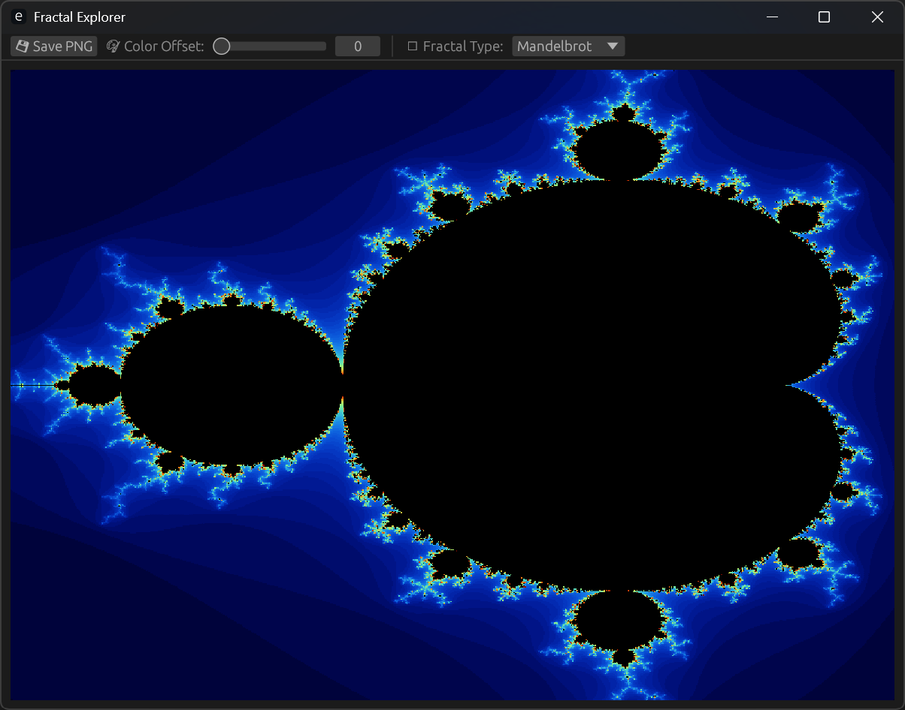

# 🌀 Fractal Explorer

A fast, modern, and GPU-accelerated fractal viewer written in Rust, powered by [`egui`](https://github.com/emilk/egui), [`eframe`](https://github.com/emilk/egui/tree/master/crates/eframe), and [`wgpu`](https://github.com/gfx-rs/wgpu). Zoom into the infinite, drag around the Mandelbrot set, toggle different fractal types, and enjoy real-time rendering — even on touch screens.



---

## ✨ Features

- ✅ **CPU Rendering** (Mandelbrot, Julia, Burning Ship)
- ✅ **Touch support** with pinch-to-zoom and drag
- ✅ **Mouse input** with:
  - Scroll to zoom
  - Click & drag to pan
  - Double-click to zoom (Shift + double-click to zoom out)
- ✅ **Low-res preview mode** while interacting
- ✅ **Color offset slider** for trippy gradient effects
- ✅ **Fractal type selector** in dropdown
- ✅ **PNG image export**
- ⚙️ **Dynamic canvas sizing** (auto-scales to window)
- WORK in progress, GPU rendering

---

## 🖥️ Requirements

- Rust (latest stable)
- A GPU that supports WGPU (most modern hardware)

---

## 🚀 Running

```bash
git clone https://github.com/YOUR_USERNAME/C2Fractal.git
cd C2Fractal
cargo run --release